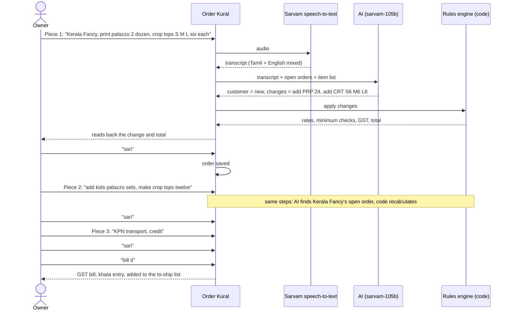
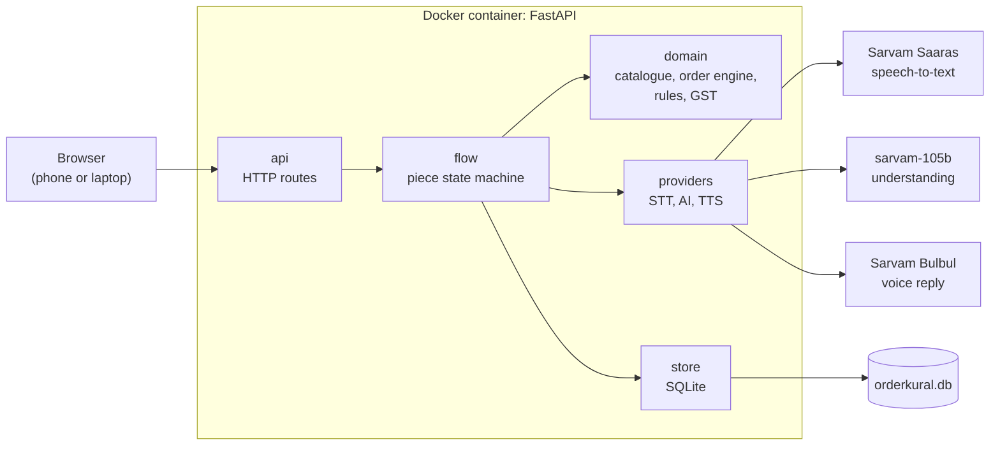
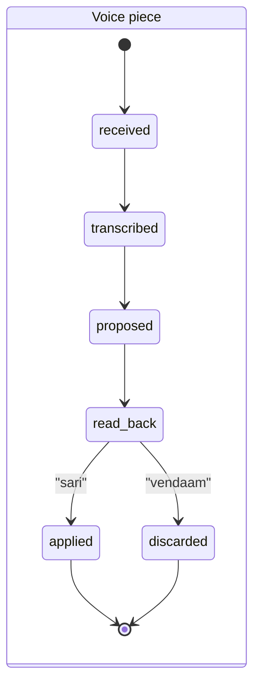
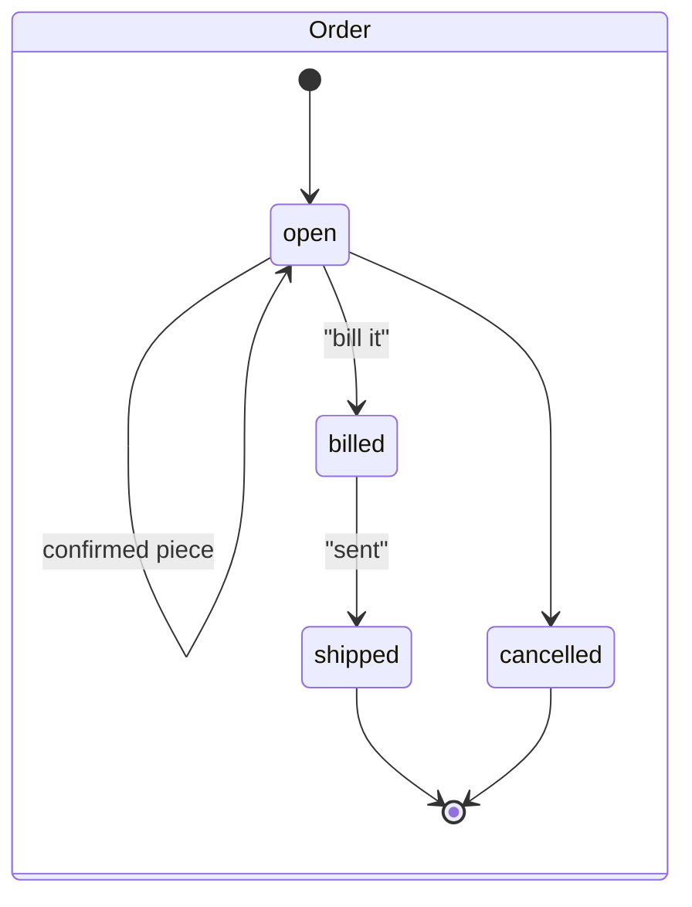

# Order Kural

**The shop's ledger that listens.** Listens like ChatGPT, remembers like Tally.

A voice-first order book for small garment wholesalers in Tirupur, Tamil Nadu. Built for the Scaler × Wispr
"India Runs on Voice" hackathon (track: livelihoods and small business).

> **Status:** S0 (app starts with no keys) and S1 (order engine + sample conversation) in progress. Live voice (S2–S4),
> bill and khata (S5) come next.

---

## The problem

- **The order lives everywhere.** One customer's order arrives in pieces: a call, a voice note, another call, in Tamil,
  Malayalam, Kannada or Hindi.
- **It gets written three times:** an order notebook, a bill, and a credit (khata) notebook.
- **Nothing remembers.** The owner stitches the pieces together from memory. Rates, minimums and GST are worked out by hand.

## What it does

1. **Speak any piece** of an order, or forward the customer's own voice note.
2. **AI finds the customer and the change:** "add kids palazzo sets", "make crop tops twelve".
3. **Code does the maths:** list rates, minimum quantities, GST. Money is exact, in paise.
4. **It reads the change back.** You say **"sari"** (OK) and only then is the order updated.
5. **Bill, khata, to-ship:** one order flows into a GST bill, a credit entry and the shipping list.

## Run it in one command

```bash
git clone https://github.com/kb2326/order-kural.git
cd order-kural
docker compose up --build
```

Open **http://localhost:8000**.

- **Works without any keys.** You will see a "key not set" banner. Press **Try the sample conversation** to watch three
  saved voice pieces build one order through the real engine.
- **Live voice:** copy `.env.example` to `.env` and set `SARVAM_API_KEY` (from [sarvam.ai](https://www.sarvam.ai/)).

Run the tests without Docker:

```bash
python -m venv .venv && .venv/bin/pip install -r requirements-dev.txt   # Windows: .venv\Scripts\pip
.venv/bin/python -m pytest -q
```

## How an order is built

Three pieces, minutes or hours apart, become one order.



## Architecture

One container. No frontend build step.



- **domain** is pure Python with no network: the same input always gives the same totals.
- **providers** sit behind small interfaces, so another speech engine (for example Wispr's API) can plug in later.
- **No key?** The providers report "not set", and the sample conversation feeds saved AI results into the same flow.

## Order life cycle

Two state machines. A **voice piece** lives for a minute; an **order** lives for days.





Nothing changes an order until the owner confirms the piece.

## Why AI, and why code

| Job | Who does it | Why |
|---|---|---|
| Hear mixed Tamil / English / Hindi speech | AI (Sarvam STT) | Code can't transcribe speech |
| Work out which customer, which item, what changed | AI (sarvam-105b) | Speech is messy: "make it twelve", "same as last time" |
| Rates, minimums, GST, totals | **Code** | Must be exact and the same every time |
| Final say | **The owner** ("sari") | A wrong bill costs money and trust |

## Project docs

How we built it, the way a product team would:

| Doc | What it covers |
|---|---|
| [Story](docs/round2/00-story.md) | The pain, why now, why voice and AI |
| [Life cycle](docs/round2/00b-lifecycle.md) | From voice note to bill, and the records kept |
| [Discovery](docs/round2/01-discovery.md) | The user, the real workflow, real voice notes |
| [Market scan](docs/round2/02-market-scan.md) | Tally, Vyapar, Khatabook, ChatGPT and the gap |
| [PRD](docs/round2/03-prd.md) | Requirements, metrics, guardrails |
| [RFC](docs/round2/04-rfc.md) | Design, data model, eval and build slices |
| [ADRs](docs/round2/adr/) | One page per key decision |

## Built by voice

This project was planned and written by dictating with [Wispr Flow](https://wisprflow.ai/).
See [built-by-voice.md](docs/round2/built-by-voice.md).
