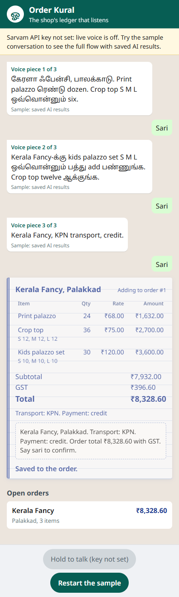
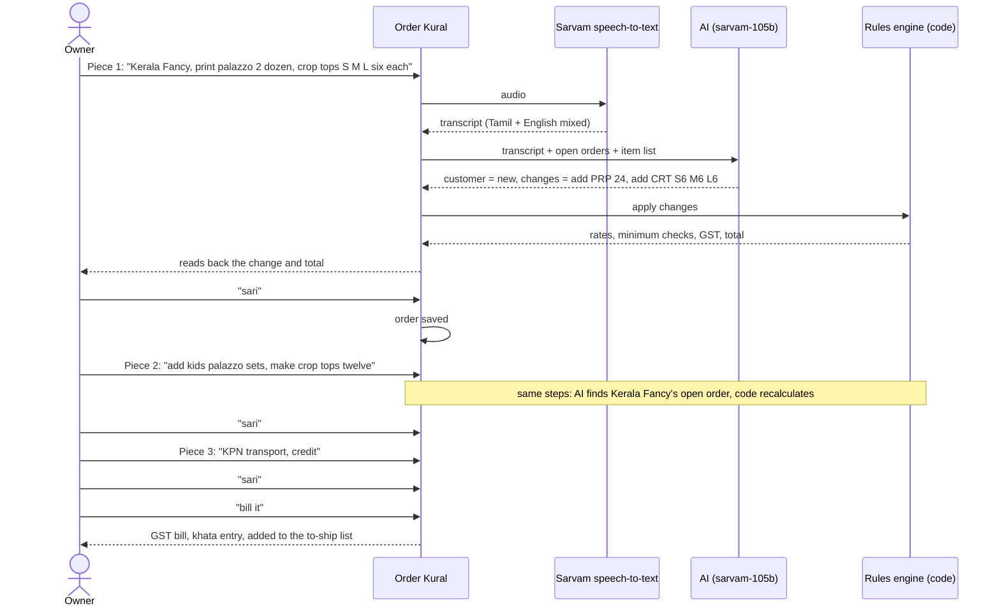
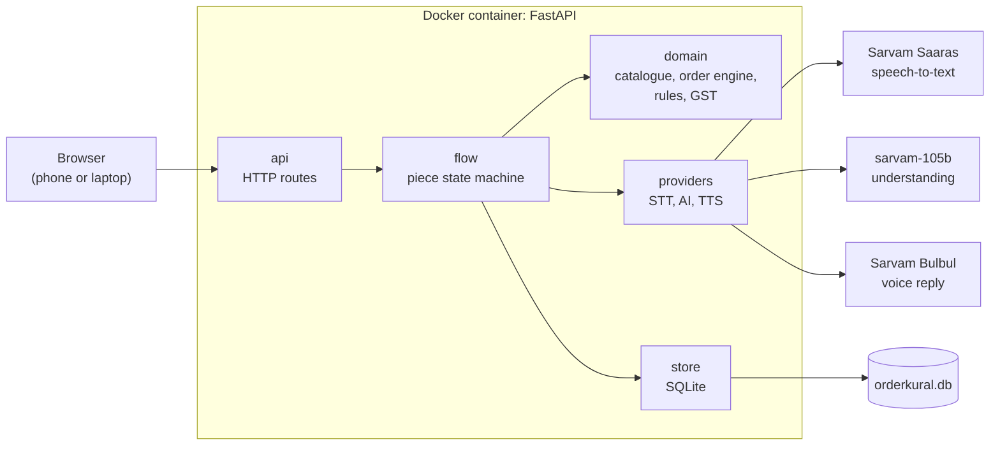
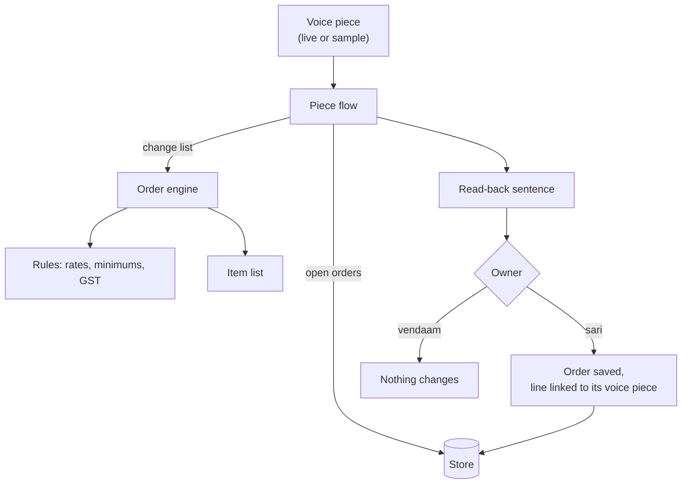
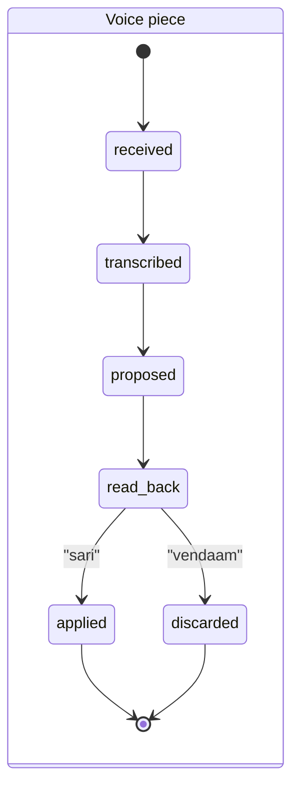
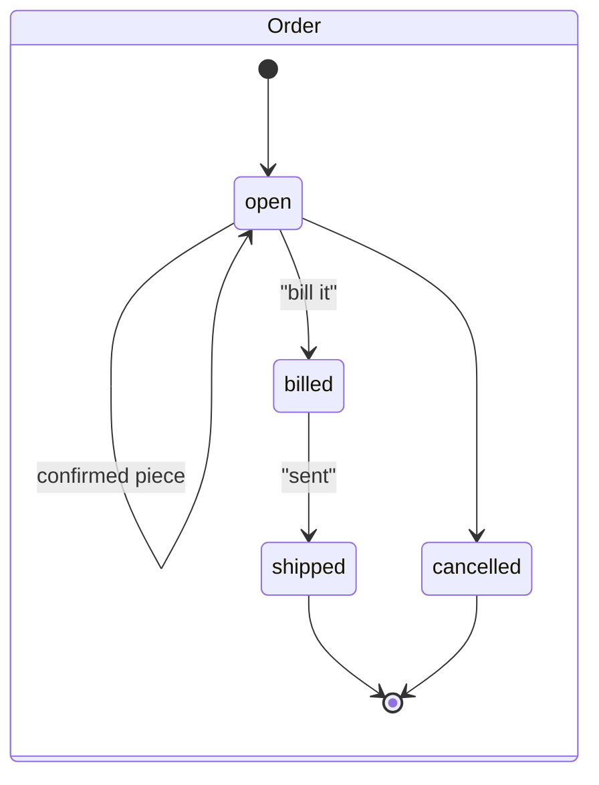

# Order Kural

**The shop's ledger that listens.** Listens like ChatGPT, remembers like Tally.

A voice-first order book for small garment wholesalers in Tirupur, Tamil Nadu. Built for the Scaler × Wispr
"India Runs on Voice" hackathon (track: livelihoods and small business).

> **Status:** working now: the app starts with no keys (S0), and the order engine plus the sample conversation run end
> to end (S1). Coming next: live voice in Tamil and other languages (S2–S4), then the bill and khata (S5).

<p align="center"></p>

---

## The problem

- **The order lives everywhere.** One customer's order arrives in pieces: a call, a voice note, another call, in Tamil,
  Malayalam, Kannada or Hindi.
- **It gets written three times:** an order notebook, a bill, and a credit (khata) notebook.
- **Nothing remembers.** The owner stitches the pieces together from memory. Rates, minimums and GST are worked out by hand.

## What it does

1. **Speak any piece** of an order, or forward the customer's own voice note.
2. **AI finds the customer and the change:** "add kids palazzo sets", "make crop tops twelve".
3. **Code does the maths:** list rates, minimum quantities, GST. Money is exact, in paise.
4. **It reads the change back.** You say **"sari"** (OK) and only then is the order updated.
5. **Bill, khata, to-ship:** one order flows into a GST bill, a credit entry and the shipping list.

## Run it in one command

```bash
git clone https://github.com/kb2326/order-kural.git
cd order-kural
docker compose up --build
```

Open **http://localhost:8000**.

- **Works without any keys.** You will see a "key not set" banner. Press **Try the sample conversation** to watch three
  saved voice pieces build one order through the real engine.
- **Live voice:** copy `.env.example` to `.env` and set `SARVAM_API_KEY` (from [sarvam.ai](https://www.sarvam.ai/)).

Run the tests without Docker:

```bash
python -m venv .venv && .venv/bin/pip install -r requirements-dev.txt   # Windows: .venv\Scripts\pip
.venv/bin/python -m pytest -q
```

## How an order is built

Three pieces, minutes or hours apart, become one order.



## Architecture

One container. No frontend build step.



### The components, in plain words

| Component | Where | What it does, simply |
|---|---|---|
| **Screen** | `app/static/` | A WhatsApp-style page. Each voice piece is a chat bubble; the proposed change appears as a bill-book page with **Sari ✔** and **Vendaam ✖** buttons. Plain HTML and JavaScript, no build step. |
| **API** | `app/api.py` | The doors the screen knocks on: play the next sample piece, confirm or discard a piece, list orders. Sends money both as exact paise and as "₹8,328.60". |
| **Piece flow** | `app/flow/pieces.py` | The traffic controller. Takes one voice piece, finds which customer's open order it belongs to, works out the change, and **holds it until the owner says "sari"**. Confirming twice, or confirming a discarded piece, is refused. |
| **Read-back** | `app/flow/readback.py` | Turns the change into one sentence to say back: "Added: Crop top S 6, M 6, L 6 at ₹75. Order total ₹3,131.10 with GST. Say sari to confirm." |
| **Item list** | `data/items.json`, `app/domain/catalog.py` | The shop's items with codes, list rates and minimum quantities, from the real notebook. Understands spoken names and near-misses ("print palazo" → Print palazzo). |
| **AI output format** | `app/domain/changes.py` | The exact shape the AI must answer in: which customer, and a list of changes (`add_line`, `change_line`, `remove_line`, `set_field`). Anything else is rejected, e.g. a negative quantity. |
| **Order engine** | `app/domain/order.py` | Applies a change list to an order. The same item twice merges into one line; an unknown item is reported, never guessed. |
| **Rules** | `app/domain/rules.py` | The maths, in code: line totals, GST (5% up to ₹2,500 a piece, else 18%), minimum-quantity and off-list-rate warnings, what's still missing (transport, payment). |
| **Store** | `app/store/db.py` | A SQLite file. Keeps customers, orders, lines, every voice piece and every applied change, so each line can be traced to the voice note it came from. |
| **Sample conversation** | `app/sample/conversation.json` | Three saved voice pieces with saved AI answers, so anyone can see the full flow **without an API key**. |
| **Providers** (next) | `app/providers/` | Speech-to-text, AI and voice reply from Sarvam, each behind a small interface so another engine (for example Wispr's API) can plug in later. |



## Order life cycle

Two state machines. A **voice piece** lives for a minute; an **order** lives for days.





Nothing changes an order until the owner confirms the piece.

## Why AI, and why code

| Job | Who does it | Why |
|---|---|---|
| Hear mixed Tamil / English / Hindi speech | AI (Sarvam STT) | Code can't transcribe speech |
| Work out which customer, which item, what changed | AI (sarvam-105b) | Speech is messy: "make it twelve", "same as last time" |
| Rates, minimums, GST, totals | **Code** | Must be exact and the same every time |
| Final say | **The owner** ("sari") | A wrong bill costs money and trust |

## Project docs

How we built it, the way a product team would:

| Doc | What it covers |
|---|---|
| [Story](docs/round2/00-story.md) | The pain, why now, why voice and AI |
| [Life cycle](docs/round2/00b-lifecycle.md) | From voice note to bill, and the records kept |
| [Discovery](docs/round2/01-discovery.md) | The user, the real workflow, real voice notes |
| [Market scan](docs/round2/02-market-scan.md) | Tally, Vyapar, Khatabook, ChatGPT and the gap |
| [PRD](docs/round2/03-prd.md) | Requirements, metrics, guardrails |
| [RFC](docs/round2/04-rfc.md) | Design, data model, eval and build slices |
| [ADRs](docs/round2/adr/) | One page per key decision |

## Built by voice

This project was planned and written by dictating with [Wispr Flow](https://wisprflow.ai/).
See [built-by-voice.md](docs/round2/built-by-voice.md).
