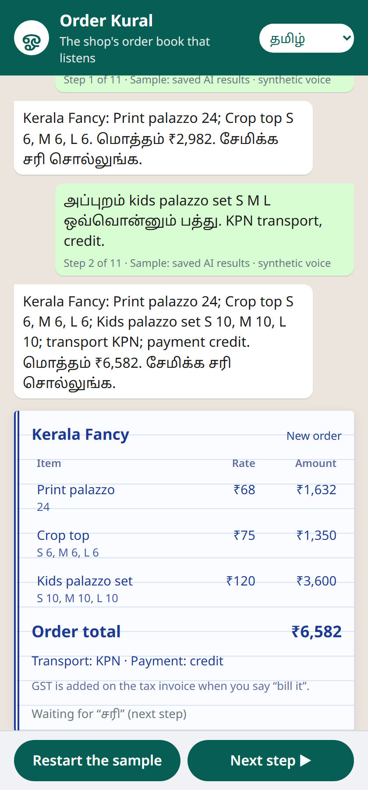
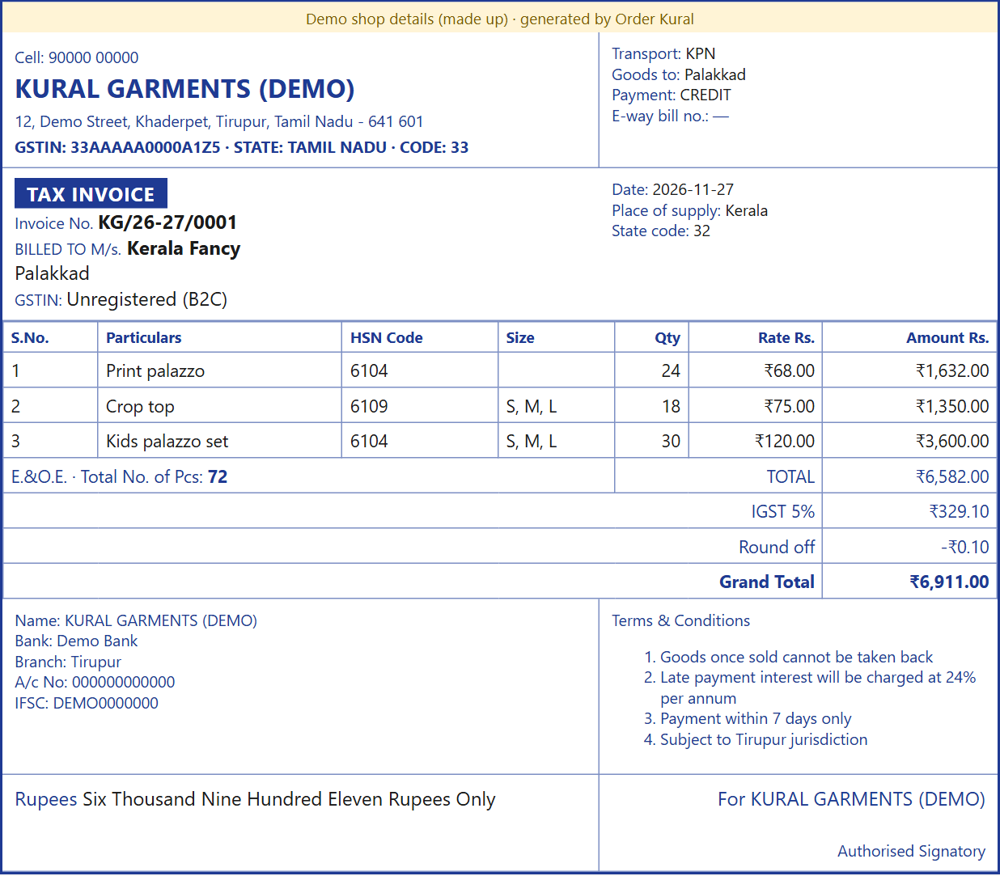
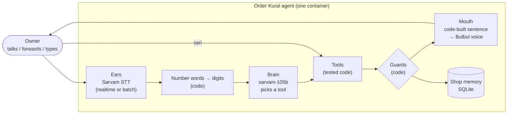
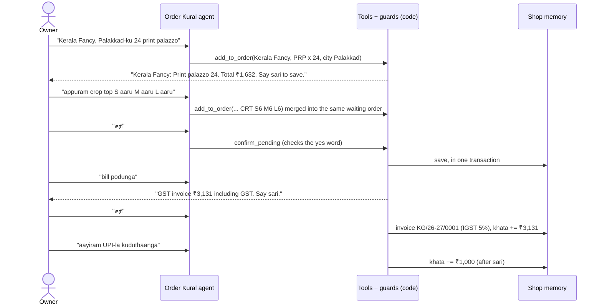
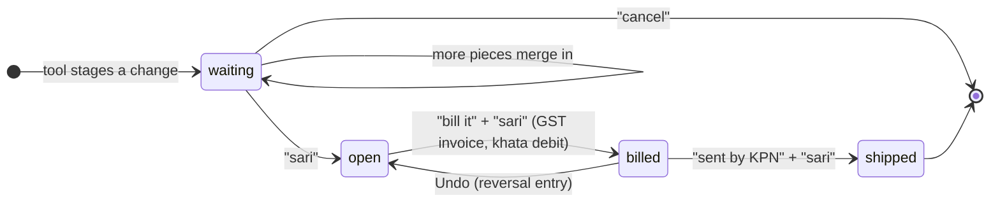

# Order Kural

**The shop's order book that listens.** A voice agent for small garment wholesalers in Tirupur, Tamil Nadu. The owner
**talks** (Tamil, Hindi, Malayalam, Kannada, mixed with English), or forwards a buyer's voice note. Order Kural builds
the order from the pieces, reads it back in his language, saves it only when he says **"sari"**, then makes the **GST
tax invoice**, the packing list and the **khata** entry, and answers questions like *"what's still to ship?"*.

Built for the Scaler × Wispr "India Runs on Voice" hackathon (track: livelihoods and small business).

<p align="center">
&nbsp;</p>

---

## The problem

- **An order arrives in pieces:** calls, forwarded WhatsApp voice notes and shop visits, in four languages, over
  hours or days. One real interstate order was **20 lines, 6,443 pieces, ₹4.6 lakh**.
- **It gets written three or four times:** a customer notebook, an order notebook, a hand-written GST invoice, and a
  credit app. The auditor gets the invoices on paper once a month.
- **Nothing remembers.** The owner stitches the pieces together from memory and works out rates, GST and balances
  by hand.

## What it does

1. **Talk, forward, or type.** Tap **Talk** and speak hands-free, interrupting at any time. Or upload a buyer's voice
   note. Or type.
2. **The agent builds one order from many pieces.** It finds the customer, adds and changes lines, and asks one
   short question when unsure (*"Which customer is this for?"*).
3. **Code does the maths and the checks:** list rates, minimum quantities, unknown items, sizes nobody said, and
   items whose code doesn't match the words.
4. **It reads back in the owner's language.** Nothing is saved until he says **"sari"** (or taps it).
5. **"Bill it"** makes a real **GST tax invoice** in the shop's own paper layout:
   - IGST for another state, CGST + SGST inside Tamil Nadu;
   - HSN codes, round-off, the amount in words;
   - B2C invoices for buyers without a GSTIN;
   - plus a **packing list** for staff.
6. **The khata:** each invoice is added to what the buyer owes, *"paid 5,000 by UPI"* is subtracted, and mistakes
   are undone by a reversal entry, never deleted.
7. **Ask the shop:** *"what's still to ship?"*, a customer's order and balance, or how many of an item were ordered
   this week. Answers are worked out by code and spoken back.
8. **For the auditor:** one tap downloads the month's invoices as a spreadsheet (CSV).

## What works today (27 Nov)

| Part | State |
|---|---|
| `docker compose up` with **no keys** shows the main screen, a "key not set" banner and the full **keyless sample** (11 steps, synthetic Bulbul voice) | ✅ Checked from a fresh clone, and by CI on every push |
| **Live voice agent** (Pipecat + Sarvam realtime STT, sarvam-105b with tools, Bulbul TTS), barge-in, 0.3-1.2 s replies | ✅ Working with a key; checked end to end in Docker |
| Typed messages and **forwarded voice notes** (cut at pauses, Sarvam STT) | ✅ Working; tested on a real customer's Hindi note |
| Order engine, guardrails, "sari" confirm, merging pieces | ✅ Unit-tested |
| **GST tax invoice**, packing list, **khata** with undo, monthly GST CSV | ✅ Unit-tested; invoice checked in a browser |
| Read-back in Tamil, Hindi, Malayalam, Kannada and English | ✅ Malayalam and Kannada wording still to be checked by native speakers |
| **Eval:** 13 conversations through the real AI | ✅ **11-12/13 fully correct, 0 wrong lines saved**, p50 about 0.4 s per turn ([report](docs/round2/05-evalset.md)) |
| Tests | ✅ 358 passing |

## Run it in one command

```bash
git clone https://github.com/kb2326/order-kural.git
cd order-kural
docker compose up --build
```

Open **http://localhost:8000**.

- **No key needed to look around:** press **Try the sample** to step through a whole day: a Tamil order in two
  pieces, "சரி", a forwarded Hindi note (the agent asks for the customer), the GST invoice, a UPI payment and *"what's
  still to ship?"*. It uses saved AI answers and a synthetic voice, all through the real agent and rules.
- **Live voice:** copy `.env.example` to `.env`, set `SARVAM_API_KEY` (from [sarvam.ai](https://www.sarvam.ai/)),
  and run `docker compose up --build` again. Then tap **Talk** (use headphones, or the agent may hear itself).
- The shop details on the invoice (`data/shop.json`) are **made up** for the demo.

Tests and the eval without Docker:

```bash
python -m venv .venv && .venv/bin/pip install -r requirements-dev.txt   # Windows: .venv\Scripts\pip
.venv/bin/python -m pytest -q
SARVAM_API_KEY=... .venv/bin/python -m eval.run                          # about ₹1.50 per run
```

## How it works: a bounded voice agent

**One rule: the AI proposes, the code decides, the owner confirms.**
- The AI only understands speech and picks a **tool**.
- Tested code does every lookup, check, sum and save.
- Every sentence about orders, money or the khata is **built by code from what the tool actually did**, so the voice
  can never claim something that didn't happen.



| Layer | Where | What it does |
|---|---|---|
| **Live voice pipeline** | `app/voice/` | Pipecat streams mic audio over a WebSocket (`/api/voice`): Sarvam realtime STT → sarvam-105b with tools → Bulbul TTS. It knows when the owner stops talking, and he can interrupt it. |
| **Text brain** | `app/agent/text_loop.py` | The same agent for typed messages, uploaded voice notes and the eval. It calls Sarvam chat with tools, at most 4 rounds per turn. |
| **Tools** | `app/agent/session.py`, `tools.py` | 12 tools. **Read:** `find_customer`, `get_open_order`, `ask_shop`. **Write** (these only *stage* a change): `add_to_order`, `change_line`, `remove_line`, `set_detail`, `bill_order`, `record_payment`, `mark_shipped`. **Approve:** `confirm_pending`, `discard_pending`. |
| **Spoken sentences** | `app/agent/say.py` | Every read-back, in 5 languages, built from tool results. Money is exact. |
| **Domain** | `app/domain/` | Item list, order engine, rules (minimums, rate checks), the GST invoice (`bill.py`, `gst.py`), the khata. All money is in integer paise. |
| **Shop services** | `app/flow/` | Piece state machine, invoice, payment, shipping, undo, and the 3 Ask questions. |
| **Store** | `app/store/db.py` | SQLite: customers, orders, lines, voice pieces, events, invoices, khata entries, and traces (time and cost of every AI call). |
| **Screen** | `app/static/` | One plain page, no build step: Talk / Upload / Type, the order slip with **Sari** and **Cancel**, invoices, khata. |
| **Eval** | `eval/` | 13 conversations scored against correct answers ([results](docs/round2/05-evalset.md)). |

### The guards: code that checks the AI's work

Each guard was added because a real test caught the AI doing that.

| The AI might… | The code… | Found by |
|---|---|---|
| invent a customer ("Sir") from a greeting | asks *"Which customer is this for?"* | Real Hindi note, 27 Nov |
| code "women's pant" as Girls pant | refuses item codes whose name doesn't fit the words (incl. women's / teen / ladies) | Real Hindi note |
| add a size nobody said ("1-10 yrs" on "shorts set 20") | refuses sizes whose numbers weren't said; keeps the other lines | Eval |
| say "added" without calling a tool | says *"That was not added. Please say it again."* | Live voice spike |
| confirm on its own | saves only if the owner's last words were a yes word, or he tapped Sari | Design |
| send the same tool call twice | ignores a repeat within one turn | Sarvam docs |
| mishear "S aaru" (S six) as "SR", or drop "irupathu naalu" (24) | turns number words and "SR" into digits before the AI sees them | Live voice, eval |

### One order, end to end



### Order life cycle



## Why AI, and why code

| Job | Who | Why |
|---|---|---|
| Hear mixed Tamil / Hindi / Malayalam / Kannada and English | AI (Sarvam STT) | Code can't transcribe speech |
| Work out which customer, which item, what changed | AI (sarvam-105b, tool calls) | Speech is messy: "make crop tops twelve", "same shop as before" |
| Rates, minimums, GST, invoices, balances, every spoken number | **Code** | Must be exact and the same every time |
| Final say | **The owner** ("sari") | A wrong invoice costs money and trust |

## What it depends on

| Service | Used for | If it gets costly or stops |
|---|---|---|
| Sarvam Saaras (speech-to-text) | Live and uploaded voice | Swap the provider in `app/providers/`; typing still works |
| Sarvam sarvam-105b (LLM) | Picking tools | Any tool-calling LLM fits the same tool definitions |
| Sarvam Bulbul (text-to-speech) | Spoken read-back | The screen shows every reply as text |
| Pipecat (open source, BSD) | Real-time voice pipeline | Runs in our container; no paid service |

The cost is measured, not guessed: about **₹0.03-0.08 per typed turn** and about **₹1.50 for the whole 13-case
eval**. Every AI call is traced with its time and estimated cost.

## Project docs

| Doc | What it covers |
|---|---|
| [Discovery](docs/round2/01-discovery.md) | The user, the real workflow, real voice notes and bills |
| [Market scan](docs/round2/02-market-scan.md) | Tally, Vyapar, Khatabook, ChatGPT and the gap |
| [PRD](docs/round2/03-prd.md), [RFC](docs/round2/04-rfc.md), [ADRs](docs/round2/adr/) | Requirements, first design, key decisions |
| [Design: the order book that listens](docs/superpowers/specs/2026-11-27-order-book-that-listens-design.md) | The approved agent design, including the GST-invoice change |
| [Eval](docs/round2/05-evalset.md) | What we measure, every run, and the limits |

## Built by voice

Planned and written by dictating with [Wispr Flow](https://wisprflow.ai/). See
[built-by-voice.md](docs/round2/built-by-voice.md).
